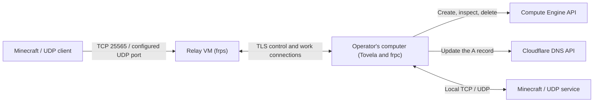

# Design

Tovela runs one relay VM per hostname. Each profile has its own Google Cloud zone, local ports, and session expiry, so profiles can run at the same time. The operator keeps the Minecraft servers and worlds on their own computer.

## Architecture

The desktop app loads zones that offer the relay machine type in the selected Google Cloud project. When the profile has no saved zone, it selects a zone in the region with the shortest measured connection time from the host computer. The app reuses the zone list and recommendation until it closes or the operator signs in to Google again. The zone selector shows the host computer's regional connection time in milliseconds using [regional Google Cloud Storage endpoints](https://docs.cloud.google.com/storage/docs/regional-endpoints). Players may get a better connection from a different zone.

The app finds the Cloudflare zone matching the hostname unless the operator selects one. Enable UDP on a profile to enter its local UDP port.

## Relay lifecycle

1. Check that the local server returns a Minecraft Java status response and look up the relay by name in the configured zone. Reuse a matching session only when its ownership labels agree.
2. Ask the operator to confirm replacement if existing A, AAAA, CNAME, or Java SRV records conflict with the relay hostname. Check that the zone offers `e2-micro` before creating a relay. Use the same `requestId` for creation retries. Look up the VM again on a name conflict. Give each new VM an ephemeral IPv4 address, a deletion deadline, and an auto-deleting boot disk.
3. Start the frp tunnel and verify the public Minecraft status response. Publish a DNS-only A record with a 60-second TTL.
4. Extend a running relay by four hours by updating its GCE termination time. The app displays the expiry confirmed by GCE.
5. On stop, remove the session's DNS record and delete its VM. Attempt VM deletion if DNS cleanup fails. After a forced app exit, GCE deletes the VM at expiry, and the next start or stop reconciles stale DNS.

## Credentials and tunnel

Google and Cloudflare sign-in uses the system browser, Authorization Code with PKCE, and the OS credential store. Google access uses the Compute Engine scope. Cloudflare access uses zone lookup and DNS write. Operators manage IAM, billing, and API access in their own cloud accounts. Apply each provider's OAuth publication requirements before distributing the app.

The build bundles a pinned `frpc` for the target OS and CPU. The VM downloads and verifies `frps` at the same version. Each session authenticates with its own token, and the client verifies the server certificate over TLS. Distributions include the frp license.

## Verification

- Start the app and verify bundled `frpc` on Windows, macOS, and Linux. Snapshot the stopped, starting, online, and error screens.
- Check concurrent starts, lost creation responses, and conflicts with a VM owned by another session.
- Run two profiles in different zones. Extend one and stop the other independently.
- Check public Java list ping, login, and UDP traffic. Verify VM and disk deletion on stop and expiry, and DNS reconciliation after a forced exit.

## References

- [GCE instance creation](https://docs.cloud.google.com/compute/docs/reference/rest/v1/instances/insert), [VM names](https://docs.cloud.google.com/compute/docs/naming-resources), and [VM runtime limits](https://docs.cloud.google.com/compute/docs/instances/limit-vm-runtime)
- [Google desktop OAuth](https://developers.google.com/identity/protocols/oauth2/native-app), [Cloudflare OAuth clients](https://developers.cloudflare.com/fundamentals/oauth/create-an-oauth-client/), and [Cloudflare DNS updates](https://developers.cloudflare.com/api/resources/dns/subresources/records/methods/edit/)
- [frp TCP and UDP](https://gofrp.org/en/docs/features/tcp-udp/) and [Fyne platforms](https://docs.fyne.io/started/quick/)
